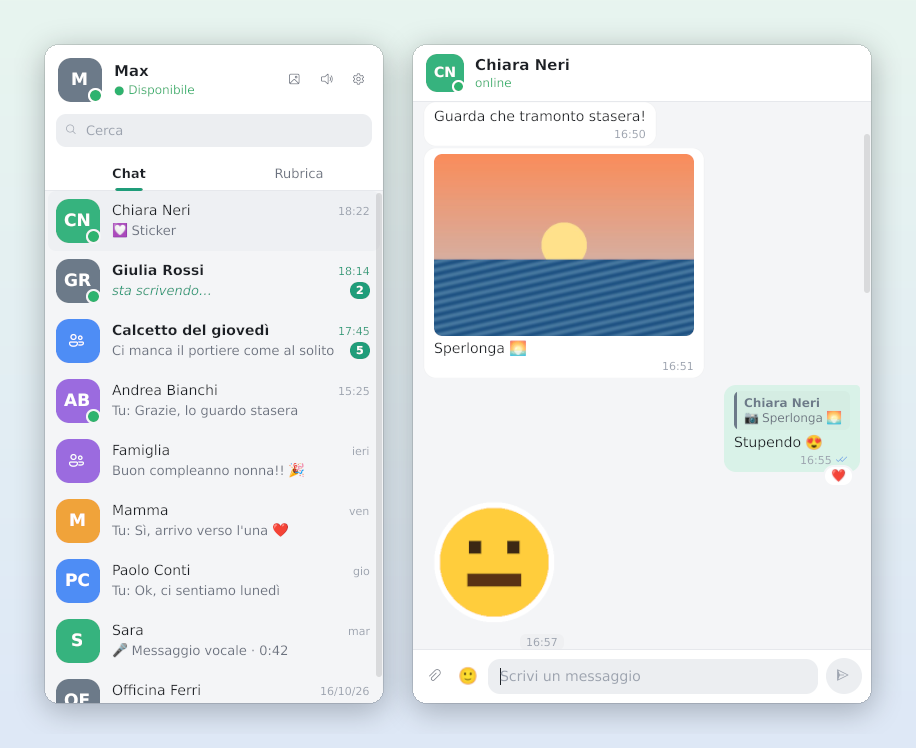
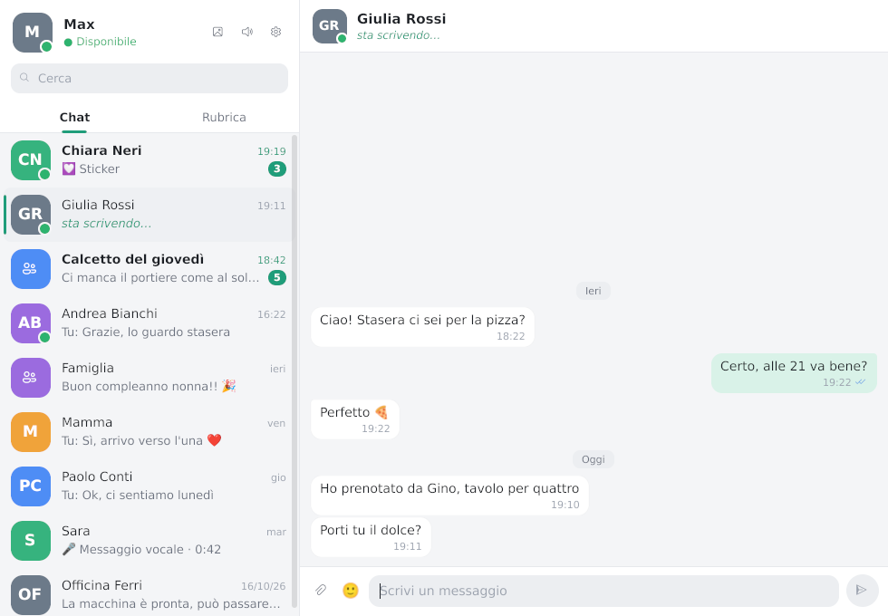
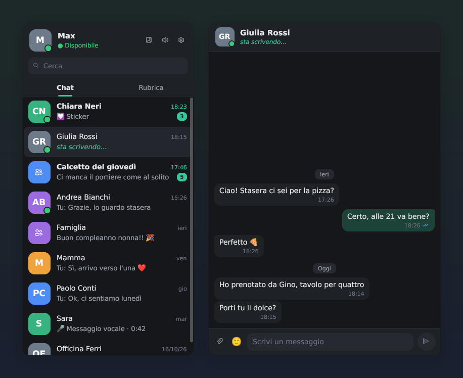
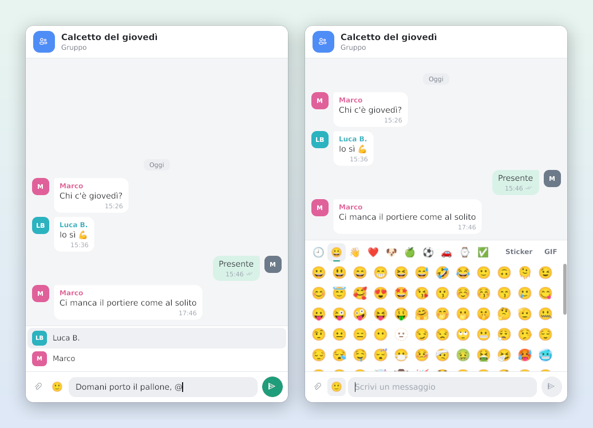
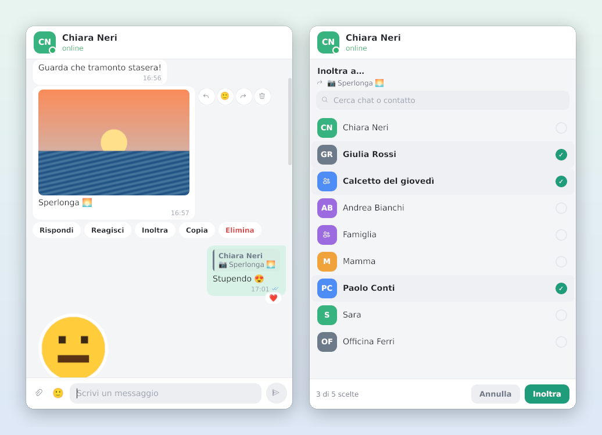
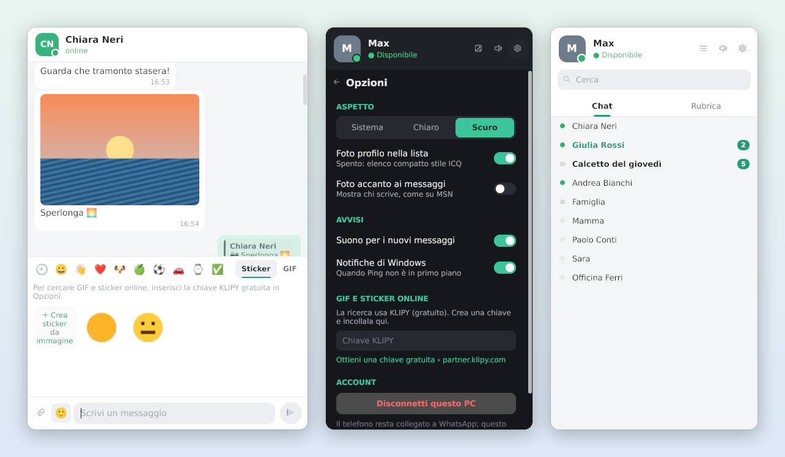

<div align="center">


# Ping

**Un client WhatsApp per Windows leggero, nativo, in stile MSN Messenger.**

Lista contatti compatta, una finestra per ogni conversazione, nessun browser nascosto dentro.

[](https://github.com/haven80/ping-whatsapp/actions/workflows/build.yml)
[](https://github.com/haven80/ping-whatsapp/releases)


[](LICENSE)

[**Scarica**](https://github.com/haven80/ping-whatsapp/releases) · [Funzioni](#funzioni) · [Come si usa](#come-si-usa) · [Privacy](#privacy-e-sicurezza) · [Compilare](#compilare-dai-sorgenti)

<br>



</div>

---

## Perché

Da fine 2025 WhatsApp per Windows è un involucro della versione web: in pratica un browser nascosto. Ping fa la stessa cosa in un unico `.exe` nativo da ~35 MB, con un'interfaccia che ricorda i messenger di una volta:

- **una finestra principale stretta** con la lista dei contatti, sempre a portata di mano;
- **una finestra per ogni chat**, da affiancare e spostare come vuoi;
- **un'icona nell'area di notifica**: chiudere la finestra non chiude Ping.

Preferisci tutto insieme? In **Opzioni › Finestre** scegli **Unica**: lista e chat affiancate in una sola finestra, con la chat a destra o a sinistra. Ogni finestra si riapre dove l'avevi lasciata, anche su un secondo schermo.

<div align="center">

<br><sub>Modalità finestra unica.</sub>
</div>

<div align="center">

<br><sub>Tema chiaro e scuro, automatico o a scelta.</sub>
</div>

## Funzioni

<table>
<tr>
<td width="50%" valign="top">

### 💬 Messaggi
- Testo, emoji a colori e le vecchie emoticon `:)` `;)` `<3` `(y)`
- **Rispondi** citando un messaggio
- **Reazioni** rapide o con qualsiasi emoji
- **Modifica** ed **elimina** (per tutti o solo per te)
- **Inoltra** fino a 5 chat in un colpo
- **Copia** il testo di un messaggio
- Spunte di consegna e lettura, "sta scrivendo…", online e ultimo accesso

</td>
<td width="50%" valign="top">

### 🖼️ Contenuti
- Foto e **sticker** a piena qualità nella chat
- **GIF animate** direttamente nella conversazione
- Video, vocali, documenti (tipo, pagine, dimensione)
- Posizioni con mappa, contatti, sondaggi, eventi
- **Link cliccabili** con anteprima (titolo, descrizione e immagine), anche quando li invii tu
- Messaggi inoltrati e "visualizza una volta"

</td>
</tr>
<tr>
<td valign="top">

### 📎 Inviare
- Foto e file con la graffetta
- **Trascina** file da Esplora risorse nella chat
- **Ctrl+V** per incollare screenshot e immagini
- Il testo scritto diventa la didascalia
- Sticker creati al volo da un'immagine o una GIF
- Ricerca di **GIF e sticker online** (KLIPY)

</td>
<td valign="top">

### 👥 Gruppi
- **Menzioni** con `@`: compare l'elenco dei partecipanti
- Le menzioni ricevute mostrano il nome, non il numero
- Nome colorato di chi scrive
- Clic su un partecipante: chat privata con lui
- Foto di chi scrive accanto ai messaggi (opzionale)

</td>
</tr>
</table>

<div align="center">

<br><sub>Menzioni nei gruppi, con le foto accanto ai messaggi, e il pannello delle emoji.</sub>
<br><br>

<br><sub>Azioni al passaggio del mouse e col tasto destro; inoltro a più chat.</sub>
<br><br>

<br><sub>Sticker, opzioni, e la vista compatta in stile ICQ (solo nomi e pallino di stato).</sub>
</div>

### E inoltre
Ricerca di chat e contatti per nome · chat archiviate · conteggio dei non letti · notifiche di Windows con suono e lampeggio sulla barra · chiamate in arrivo segnalate nella chat · una sola istanza alla volta.

## Come si usa

1. **Scarica** `Ping.exe` dalla [pagina delle versioni](https://github.com/haven80/ping-whatsapp/releases) (`Ping-arm64.exe` per i PC con processore ARM). Non serve installarlo.
2. **Avvialo.** Windows potrebbe mostrare *"Windows ha protetto il PC"*: l'eseguibile non è firmato. Scegli *Ulteriori informazioni › Esegui comunque*.
3. **Collega il telefono:** su WhatsApp apri *Impostazioni › Dispositivi collegati › Collega un dispositivo* e inquadra il codice QR.
4. Dopo la sincronizzazione compare la lista delle chat. **Un clic apre la conversazione** in una finestra a sé.

> [!TIP]
> Vuoi vedere com'è senza collegare il tuo numero? Avvia `Ping.exe -demo`: mostra l'interfaccia con conversazioni di prova. Tutte le immagini di questa pagina vengono da lì.

### Scorciatoie e gesti

| Dove | Azione | Cosa fa |
|---|---|---|
| Campo di testo | `Invio` / `Maiusc+Invio` | Invia / va a capo |
| Campo di testo | `Ctrl+V` | Incolla testo, immagini o file copiati |
| Campo di testo | `@` (nei gruppi) | Elenco dei partecipanti · `↑` `↓` per scegliere, `Invio` o `Tab` per inserire |
| Campo di testo | `Esc` | Chiude pannelli e menu, annulla risposta o modifica |
| Messaggio | Passaggio del mouse | Rispondi · Reagisci · Inoltra · Modifica · Elimina |
| Messaggio | Tasto destro | Menu con tutte le azioni, più *Copia* |
| Citazione | Clic | Salta al messaggio originale |
| Nome in un gruppo | Clic | Apre la chat privata con quella persona |
| Finestra della chat | Trascina file | Li aggiunge come allegati |
| Icona nell'area di notifica | Clic destro › *Esci* | Chiude Ping davvero |

### Opzioni

Dall'ingranaggio in alto nella finestra principale:

- **Tema:** Sistema, Chiaro o Scuro
- **Foto profilo nella lista:** spente, la lista diventa compatta in stile ICQ
- **Foto accanto ai messaggi:** mostra chi scrive, come su MSN
- **Suoni e notifiche** di Windows
- **Chiave KLIPY** per cercare GIF e sticker online
- **Disconnetti questo PC**

### GIF e sticker online

Tenor, il servizio di Google, ha chiuso la sua API il 30 giugno 2026. Ping usa **[KLIPY](https://klipy.com)**, lo stesso servizio adottato da WhatsApp: è gratuito ma serve una chiave personale. Creala su [partner.klipy.com](https://partner.klipy.com) e incollala in *Opzioni › GIF e sticker online*. Senza chiave puoi comunque reinviare quelli ricevuti o crearne di nuovi dai file del PC.

## Privacy e sicurezza

- **Cifratura end-to-end come WhatsApp ufficiale.** Ping è un normale *dispositivo collegato*: i messaggi vengono cifrati sul PC con il protocollo Signal, e i file con una chiave casuale prima di essere caricati. I server vedono solo dati cifrati.
- **Nessun server intermedio.** Ping parla direttamente con WhatsApp. L'unico altro servizio contattato è KLIPY, e solo se inserisci una chiave: riceve il testo che cerchi e un identificativo anonimo, mai il contenuto delle chat.
- **Dati in locale.** Sessione, messaggi e file scaricati stanno in `%APPDATA%\Ping` e **non sono cifrati sul disco**: chi accede al tuo account Windows può leggerli. Per scollegare Ping in qualsiasi momento: *WhatsApp sul telefono › Dispositivi collegati*.

| File in `%APPDATA%\Ping` | Contenuto |
|---|---|
| `session.db` | Chiavi del dispositivo collegato |
| `ping.db` | Chat e messaggi |
| `media\`, `avatars\` | File scaricati e foto profilo |
| `settings.json` | Opzioni |
| `crash.log` | Eventuali errori (Ping prova a proseguire invece di chiudersi) |

Cancellando la cartella si riparte da zero.

## Limiti

- **Chiamate vocali e video:** compaiono nella chat, ma si rispondono dal telefono.
- **Non ancora supportati:** voto nei sondaggi, registrazione di vocali, stati.
- **Video normali:** si aprono nel lettore di Windows. Le GIF invece si animano nella chat.

> [!WARNING]
> **Ping non è un prodotto WhatsApp né Meta, e non è affiliato a loro.** Usare un client non ufficiale va contro i termini di servizio di WhatsApp. Per un uso personale normale i blocchi sono rari, ma il rischio non è zero e riguarda il tuo numero vero. Se vuoi provarlo con prudenza, inizia con un numero secondario.

## Domande frequenti

<details>
<summary><b>Il QR è scaduto, cosa faccio?</b></summary>

Premi *Nuovo codice* nella finestra di Ping e inquadra quello nuovo.
</details>

<details>
<summary><b>Dove sono finiti i messaggi vecchi?</b></summary>

Alla prima connessione il telefono invia a Ping solo la cronologia recente, come succede con WhatsApp Web, e Ping ne conserva gli ultimi 60 messaggi per chat. Da quel momento in poi i messaggi nuovi arrivano tutti e restano salvati.
</details>

<details>
<summary><b>Ho chiuso la finestra ma Ping è ancora attivo</b></summary>

È voluto: resta nell'area di notifica per farti arrivare i messaggi. Per chiuderlo davvero: clic destro sull'icona › *Esci*.
</details>

<details>
<summary><b>Qualcosa non funziona</b></summary>

Apri una [segnalazione](https://github.com/haven80/ping-whatsapp/issues) allegando, se c'è, il file `%APPDATA%\Ping\crash.log`. Prima di pubblicarlo, controlla che non contenga informazioni personali.
</details>

## Compilare dai sorgenti

Ping è scritto in **Go**, senza cgo: si compila per Windows da qualsiasi sistema.

```bash
git clone https://github.com/haven80/ping-whatsapp.git
cd ping-whatsapp
go run github.com/tc-hib/go-winres@latest make --arch amd64      # icona e informazioni sul file
GOOS=windows GOARCH=amd64 go build -trimpath -ldflags "-s -w -H windowsgui" -o Ping.exe .
```

**Con GitHub Actions** ([`.github/workflows/build.yml`](.github/workflows/build.yml)):

1. a ogni push vengono eseguiti controlli e test su Windows;
2. se passano, Ping viene compilato per x64 e ARM64;
3. gli `.exe` si scaricano da *Actions › Artifacts*.

Un tag `v*` (per esempio `git tag v1.0.0 && git push --tags`) pubblica una Release con gli eseguibili già allegati.

<details>
<summary><b>Com'è fatto</b></summary>

| Parte | Tecnologia |
|---|---|
| Protocollo WhatsApp | [whatsmeow](https://github.com/tulir/whatsmeow), lo stesso usato dai bridge mautrix per Matrix |
| Interfaccia | [Gio](https://gioui.org), interfaccia nativa disegnata sulla GPU |
| Archivio locale | SQLite in Go puro ([modernc.org/sqlite](https://gitlab.com/cznic/sqlite)) |
| Video e GIF | Media Foundation di Windows: niente ffmpeg |
| Sticker WebP | [nativewebp](https://github.com/HugoSmits86/nativewebp) |
| Integrazione con Windows | API Win32: area di notifica, appunti, trascinamento, notifiche |

</details>

## Crediti e licenze

Ping è software libero, distribuito con licenza **GNU GPL v3** (vedi [LICENSE](LICENSE)). Usa queste librerie, che mantengono le proprie licenze:

| Libreria | Licenza |
|---|---|
| [whatsmeow](https://github.com/tulir/whatsmeow) | Mozilla Public License 2.0 |
| [Gio](https://gioui.org) | MIT / Unlicense |
| [modernc.org/sqlite](https://gitlab.com/cznic/sqlite) | BSD |
| [nativewebp](https://github.com/HugoSmits86/nativewebp), [go-qrcode](https://github.com/skip2/go-qrcode) | MIT |
| [Noto Color Emoji](https://github.com/googlefonts/noto-emoji) | SIL Open Font License (vedi `fonts/`) |

WhatsApp è un marchio di WhatsApp LLC. Ping è un progetto indipendente e non è collegato, approvato o sponsorizzato da WhatsApp o Meta.

<div align="center">
<sub>Fatto da <a href="https://github.com/haven80">HaVeN80</a></sub>
</div>
